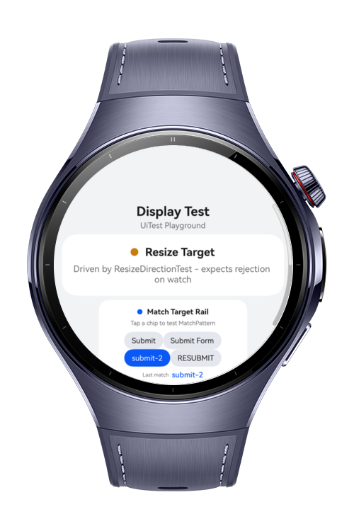
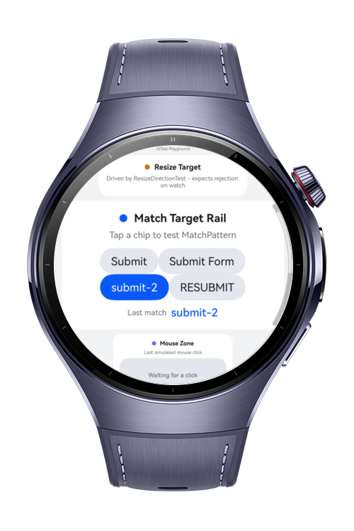
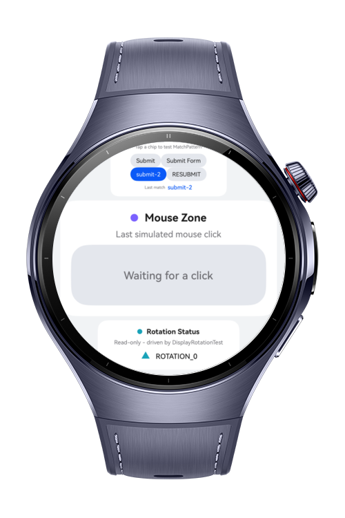
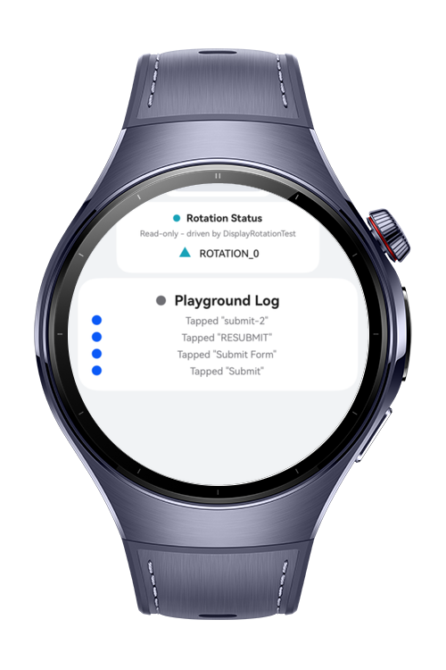

> **Note:** To access all shared projects, get information about environment setup, and view other guides, please visit [Explore-In-HMOS-Wearable Index](https://github.com/Explore-In-HMOS-Wearable/hmos-index).

# How to Build Display Test

This codelab demonstrates **UiTest display/window/input APIs** (`ResizeDirection`, `MouseButton`, `MatchPattern`, `DisplayRotation`) on a HarmonyOS wearable device. The app is a single round-face **Playground** page exposing a resize target, a match-pattern button rail, a mouse-click zone, and a rotation status readout. An `ohosTest` suite built on `@kit.TestKit` (`Driver`, `UiWindow`, `On`) drives all four APIs end to end — including the two, `ResizeDirection` and `DisplayRotation`, that the UiTest reference itself documents as restricted or a no-op on a wearable, so the suite asserts *documented* device behavior instead of assuming every UiTest API behaves the same on every form factor.

# Preview

<div>
  
  
  
  
</div>

# Use Cases

- **Attempt to resize the window** — `ResizeDirectionTest` drives `UiWindow.resize()` through all 8 `ResizeDirection` values (`LEFT`/`RIGHT`/`UP`/`DOWN` and the 4 diagonals) and asserts every call is rejected with error `17000005` ("This operation is not supported."), the documented outcome on device types other than Phone/PC/2in1/Tablet.
- **Click the mouse zone** — `MouseButtonTest` drives `mouseClick()`/`mouseDoubleClick()`/`mouseLongClick()` with every `MouseButton` value (plus a Ctrl-modifier long-click) at the Playground's `MouseZone`, and asserts the zone's `onMouse` handler reports the matching button and click action.
- **Match a rail button** — `MatchPatternTest` builds an `On.text(txt, pattern)` matcher for every `MatchPattern` value (`EQUALS`/`CONTAINS`/`STARTS_WITH`/`ENDS_WITH`/`REG_EXP`/`REG_EXP_ICASE`) against the rail's deliberately overlapping labels ("Submit", "Submit Form", "submit-2", "RESUBMIT") and asserts each resolves the expected button, or `null` for the intentional non-matches that show `REG_EXP` is case-sensitive and `REG_EXP_ICASE` isn't.
- **Attempt to rotate the display** — `DisplayRotationTest` reads a baseline via `getDisplayRotation()`, then cycles `setDisplayRotation()`/`setDisplayRotationEnabled()` through all 4 `DisplayRotation` values, asserting the reported rotation never leaves that baseline — the documented no-op outcome on a wearable.
- **Watch it live** — `PlaygroundPage` mirrors the last mouse click, the last matched button, and the live rotation readout, plus an on-screen log of the last few recognized actions, so a tester can visually corroborate what the `ohosTest` suite just asserted.

# Tech Stack

- **Languages:** ArkTS
- **Frameworks:** HarmonyOS SDK, API version 6.0.1(21)+
- **Tools:** DevEco Studio 6.0.1 or later
- **Libraries & Kits:**
    - `@kit.TestKit` — `Driver`, `UiWindow`, `Component`, `On`/`ON`, `MatchPattern`, `ResizeDirection`, `MouseButton`, `DisplayRotation`
    - `@kit.ArkUI` — `ArcList`, `ArcListItem`, `display` (`getDefaultDisplaySync()`, `on('change', ...)`)
    - `@ohos/hypium` / `@ohos/hamock` — `ohosTest` test runner

# Directory Structure

```
how-to-build-display-test/
├── build-profile.json5
├── AppScope/
│   └── app.json5
└── entry/
    ├── build-profile.json5
    └── src/
        ├── main/
        │   ├── module.json5
        │   ├── ets/
        │   │   ├── entryability/
        │   │   │   └── EntryAbility.ets          # UIAbility hosting the Playground page
        │   │   ├── entrybackupability/
        │   │   │   └── EntryBackupAbility.ets    # Default backup extension ability
        │   │   ├── model/
        │   │   │   └── PlaygroundModels.ets      # MatchTargetItem list, PlaygroundLogEntry, MOUSE_ZONE_ID
        │   │   └── pages/
        │   │       └── Index.ets                 # PlaygroundPage - rail, mouse zone, rotation status, log
        │   └── resources/base/element/
        └── ohosTest/
            ├── module.json5
            └── ets/test/
                ├── List.test.ets                   # Registers every suite below
                ├── Ability.test.ets                 # Default sanity test
                ├── ResizeDirectionTest.test.ets      # UiWindow.resize() x ResizeDirection
                ├── MouseButtonTest.test.ets           # Driver.mouseClick/mouseDoubleClick/mouseLongClick x MouseButton
                ├── MatchPatternTest.test.ets          # On.text() x MatchPattern
                └── DisplayRotationTest.test.ets       # Driver.setDisplayRotation/getDisplayRotation/setDisplayRotationEnabled x DisplayRotation
```

# Constraints and Restrictions

## Supported Devices

- HarmonyOS wearable Watch 5

# License

**How to Build Display Test** is distributed under the terms of the MIT License.
See the [LICENSE](./LICENSE) for more information.
